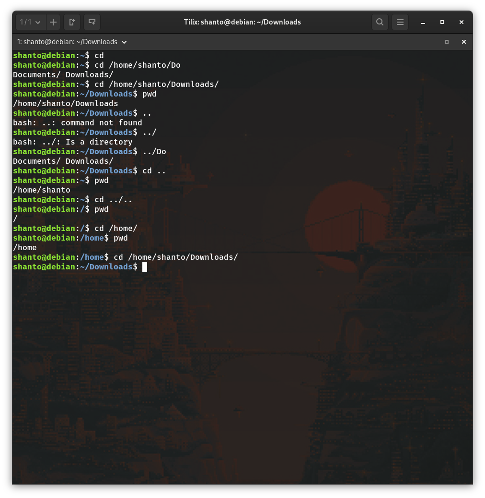
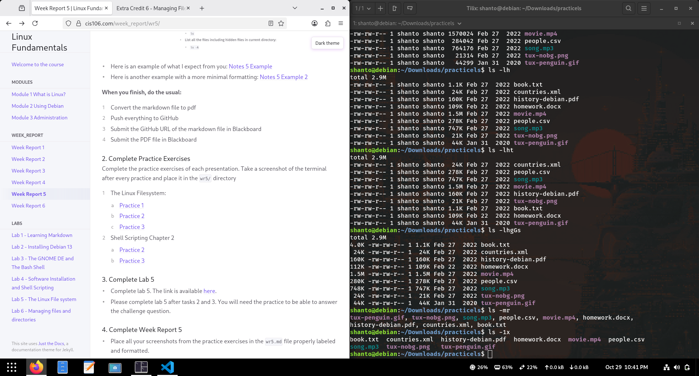
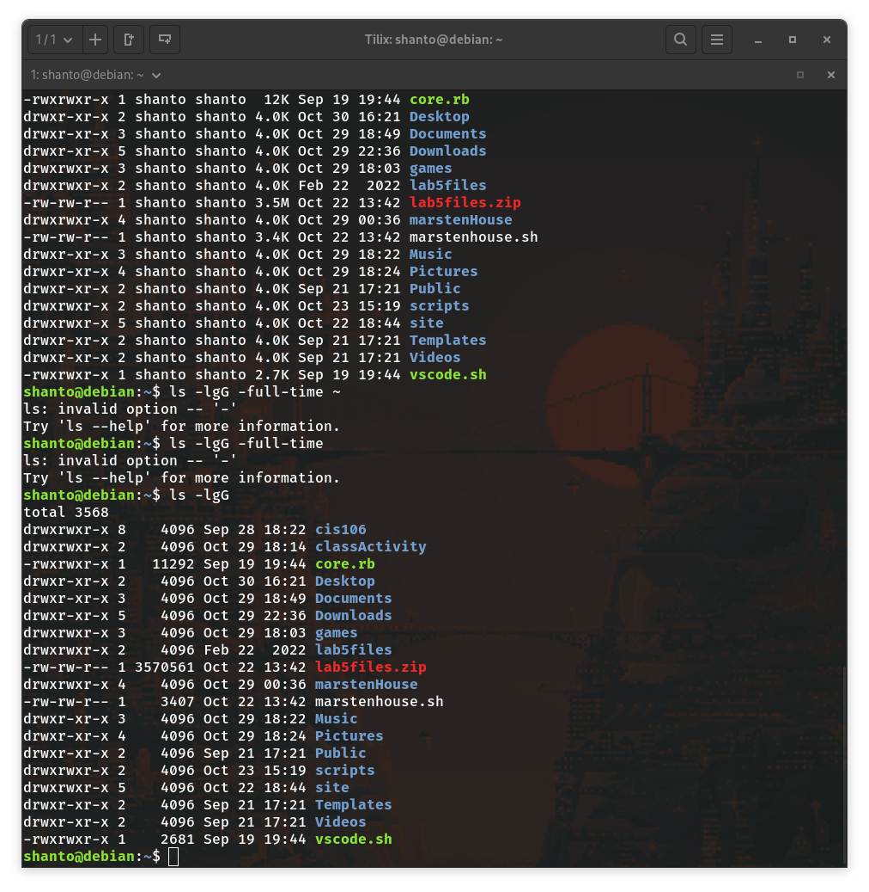
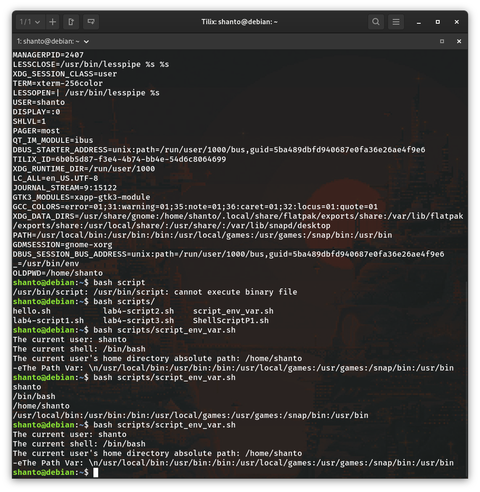
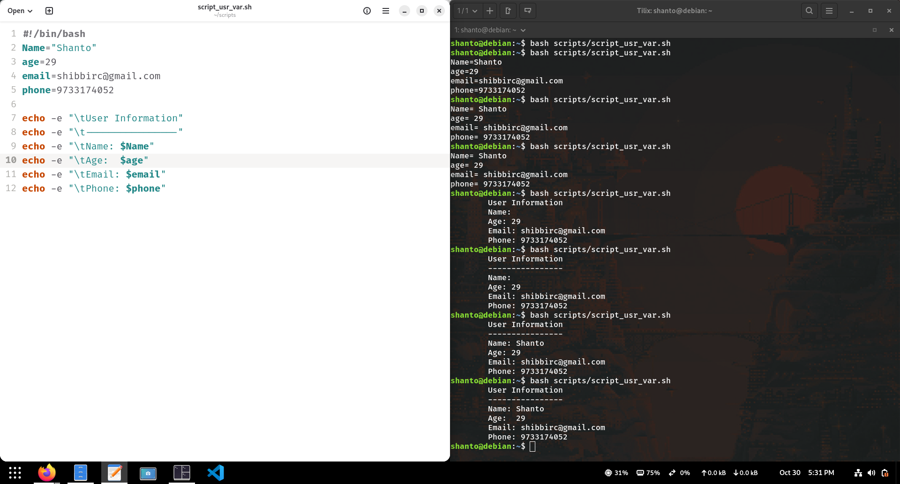

# Week Report 5 

## Practice Exercises
### The Linux File system: 
* **Number 1**

* **Number 2**

* **Number 3**

### The Linux Filesystem: 
* **Number 1**

* **Number 2**

# Lab 5
* [Lab5](../../Labs/lab5/lab5.md)
# Note 5
* [Note5](../../Notes/note5/note5.md)
